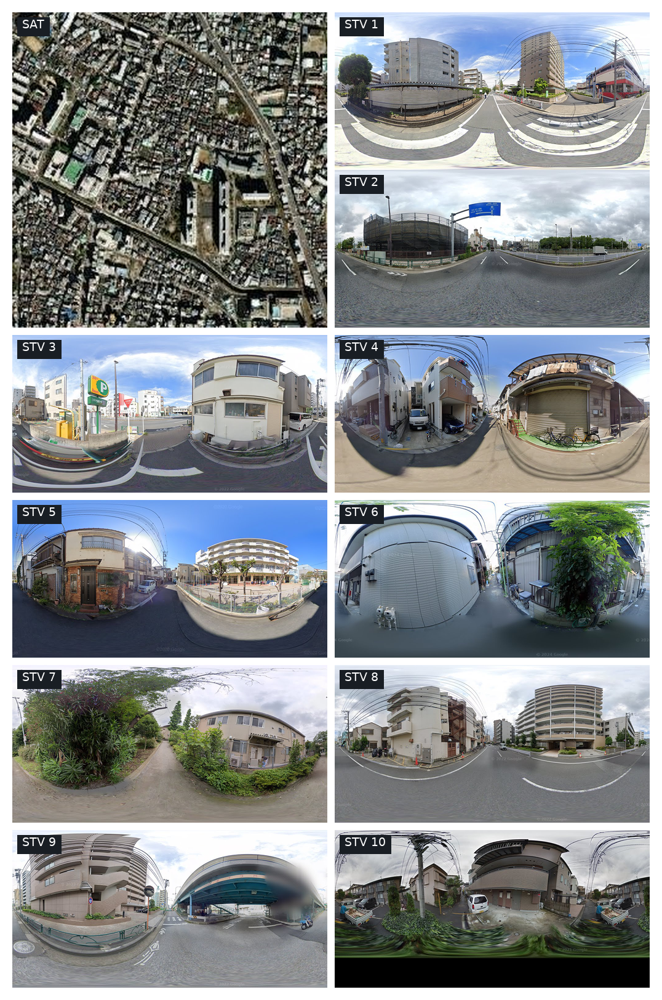
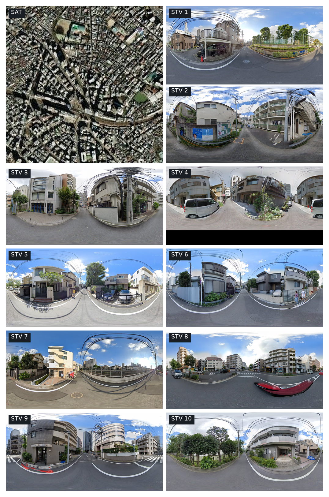
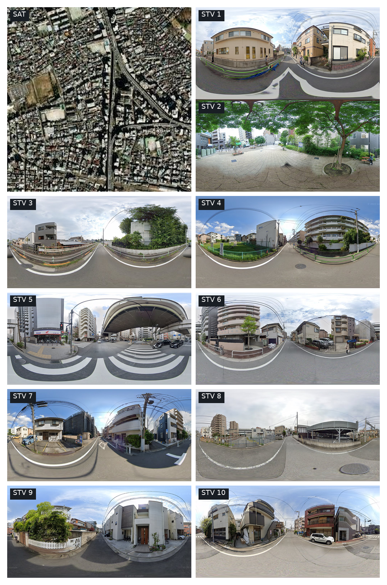
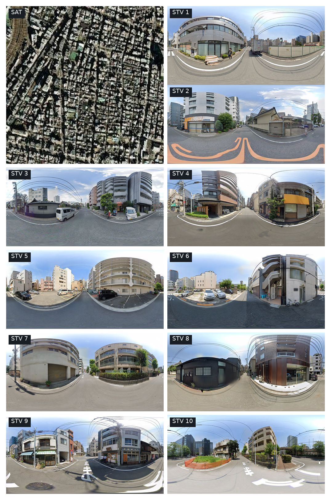

# UrbanMIL reproducibility code

This directory contains the codes for reproducing UrbanMIL framework. It predicts `reference_normalized` GDP, population, or house price from one satellite image and ten street view images per region. The input data are from the [CityLens dataset](https://huggingface.co/datasets/Tianhui-Liu/CityLens-Data), introduced by Liu et al. in [*CityLens: Evaluating Large Vision-Language Models for Urban Socioeconomic Sensing*](https://arxiv.org/abs/2506.00530).

## Environment

Use Python 3.10+ and install the dependencies listed in `requirements.txt`
with a PyTorch build suited to your GPU. The ViT extractor uses the pretrained `timm` ViT-B/16 evaluation transform and CLS feature.

## Inputs

All commands below use the same CityLens task JSON, with eleven image paths
per row: satellite first, then ten street view images. Its row order determines `sample_000000`, `sample_000001`, and so on when `region_id` is absent. Image paths are resolved by basename beneath the given image root. The split JSON has `train_ids`, `val_ids`, and `test_ids`, which partition the task regions.

### 1. Extract ViT-B/16 features

```bash
python extract_vit_features.py \
  --task_json /path/to/all_global_gdp_task.json \
  --image_root /path/to/Citylens_images \
  --output /path/to/gdp_vit_base_features.pt \
  --model_name vit_base_patch16_224 \
  --batch_size 32 --device cuda
```

The `.pt` output is keyed by region ID. Each record contains `sat` and `street`; it contains no indicator label. The training script reads
`reference_normalized` labels from the task JSON.

### 2. Extract structured semantic profiles

```bash
python extract_semantics_qwen_structured_all_indicator_parallel.py \
  --json_path /path/to/all_global_gdp_task.json \
  --out_json /path/to/gdp_semantic_profiles.json \
  --base_img /path/to/Citylens_images \
  --model_name Qwen/Qwen3-VL-8B-Instruct \
  --gpus 0,1 --max_new_tokens 512 --flush_every 10 --resume

python validate_semantic_profiles.py \
  --task_json /path/to/all_global_gdp_task.json \
  --semantic_profiles /path/to/gdp_semantic_profiles.json
```

Use `--gpus 0` for one GPU. It generates 30 scores in five groups and one
uncertainty score per region.

### 3. Train and evaluate the full model

```bash
python run_framework.py \
  --visual_features /path/to/gdp_vit_base_features.pt \
  --semantic_profiles /path/to/gdp_semantic_profiles.json \
  --task_json /path/to/all_global_gdp_task.json \
  --split_json /path/to/fold1/split.json \
  --output /path/to/runs/gdp_fold1_urbanmil \
  --device cuda
```

The script first selects balanced satellite and street view supports according to their relevance weights. It then fits a directional visual label adjustment. With that visual model fixed, it fits query and query-support semantic corrections. 

Defaults are `K=64`, AdamW learning rates
`2e-2/1e-3/2e-3`, batch size 16, patience 15, and seed 41.

## An Inspectable GDP Prediction

The following held-out test example shows how UrbanMIL predicts the `reference_normalized` GDP value for region `sample_000303`. It is an illustrative case; the reported evaluation metrics are computed over the full test set.

| Prediction step | Value |
|---|---:|
| Weighted average of retrieved labels | 9.3711 |
| Directional visual adjustment | −0.3566 |
| Visual prediction | 9.0146 |
| Query semantic adjustment | +0.2564 |
| Query–support semantic adjustment, across all 64 supports | +0.1338 |
| **Final prediction** | **9.4048** |
| Ground truth | 9.4000 |

The absolute error decreases from 0.3854 for the visual prediction to 0.0048 for the final prediction. Values in this table are rounded, so displayed sums may differ slightly in the last decimal place.

The images below show the query and its three highest-weight retrieved regions. Each montage contains one satellite image and ten street view images.

<table>
<tr>
<td><strong>Query: sample_000303</strong><br><a href="gdp_sample_000303/images/query.png"></a></td>
<td><strong>Support 1: sample_000162</strong><br><a href="gdp_sample_000303/images/support_01_sample_000162.png"></a></td>
</tr>
<tr>
<td><strong>Support 2: sample_000207</strong><br><a href="gdp_sample_000303/images/support_02_sample_000207.png"></a></td>
<td><strong>Support 3: sample_000336</strong><br><a href="gdp_sample_000303/images/support_03_sample_000336.png"></a></td>
</tr>
</table>


| Retrieved region | Observed GDP label | Visual weight | Weighted visual adjustment | Weighted semantic pair adjustment |
|---|---:|---:|---:|---:|
| `sample_000162` | 9.800 | 0.3975 | −0.1045 | +0.0879 |
| `sample_000207` | 9.300 | 0.2551 | −0.2041 | −0.0058 |
| `sample_000336` | 9.900 | 0.0506 | +0.0033 | +0.0005 |

Each visual weight determines how strongly a retrieved region contributes to the prediction. The two adjustment columns show that region's signed contribution to the visual and semantic corrections; the final prediction aggregates all 64 supports and adds a separate query-level semantic adjustment.

These three regions account for 70.32% of the visual support weight. The weights express relative contributions among the 64 retrieved regions. Semantic adjustments are signed learned contributions, not causal effects. For example, the query and first support have MLLM-estimated land-use-mix scores of 0.50 and 0.40, respectively; this attribute contributes +0.0252 to that support's weighted semantic adjustment.

The [case data](gdp_sample_000303/case.json) contains the full semantic profiles, support-level calculations, and prediction decomposition. The [case explanation](gdp_sample_000303/case.md) provides a shorter text summary.