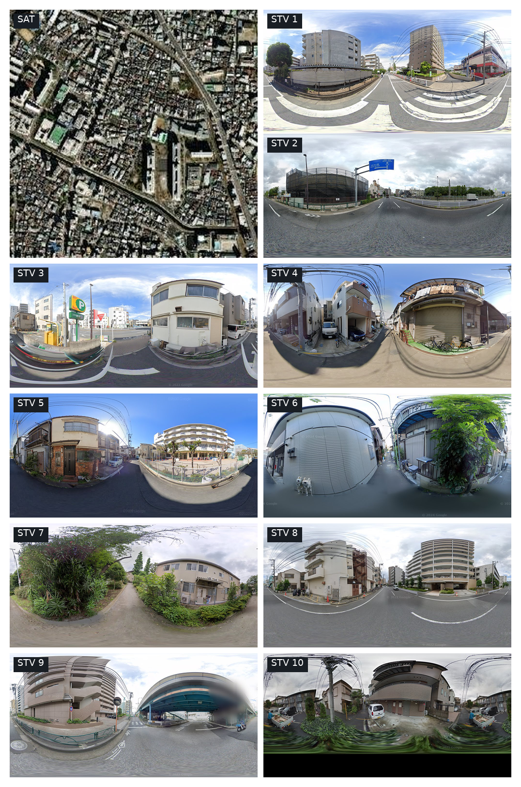
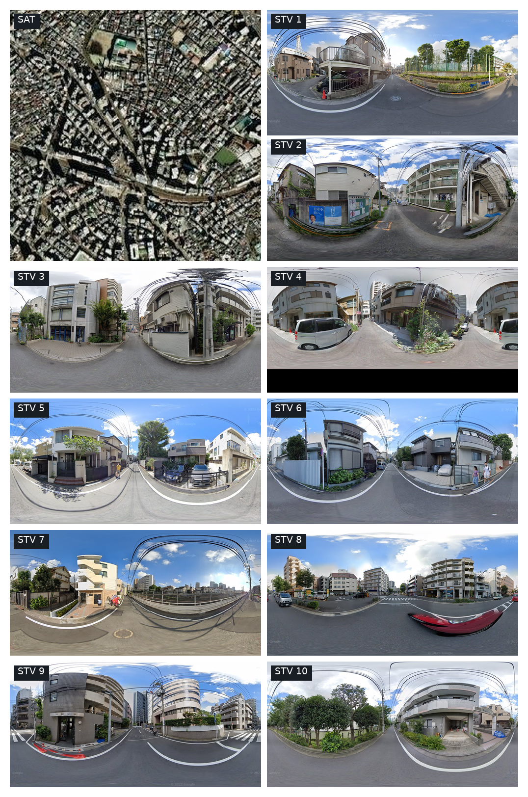
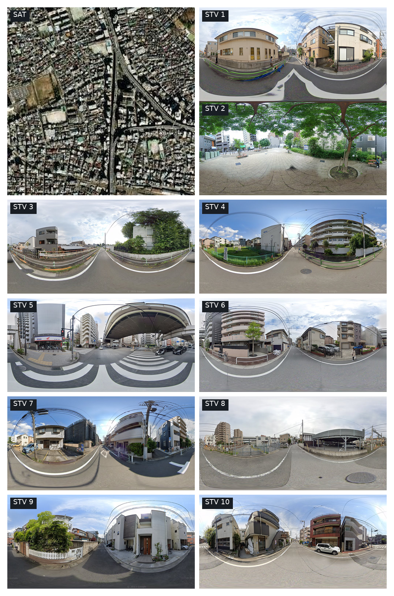
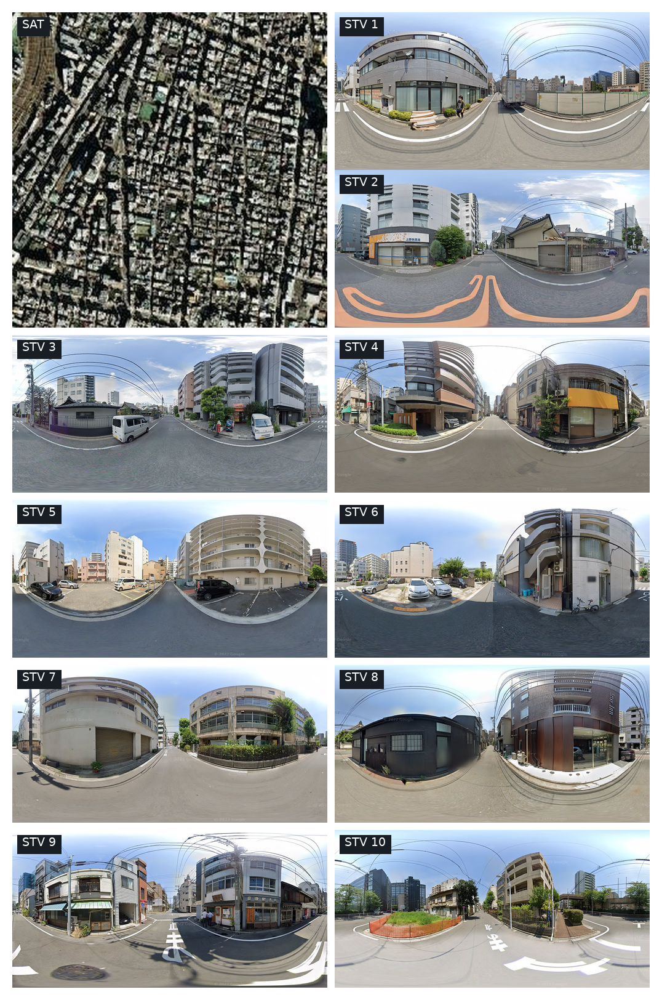

# UrbanMIL image example: sample_000303

Truth 9.400; visual 9.015; final 9.405 (`reference_normalized`).

Each PNG contains one satellite image and ten street view images. Street view panels have half the displayed satellite height.

## Query

## Support sample_000162 (visual weight 0.3975)

## Support sample_000207 (visual weight 0.2551)

## Support sample_000336 (visual weight 0.0506)

